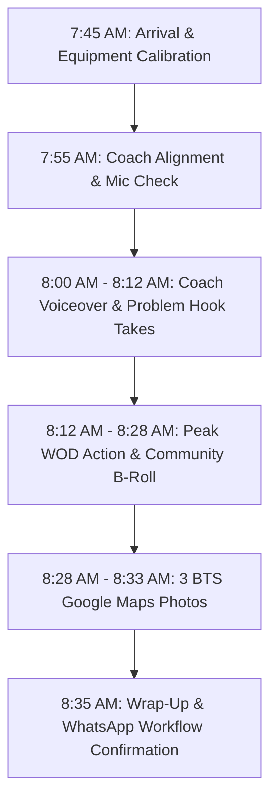

# 🏋️ Fionis CrossFit Navalur — On-Location Production Packet & Field Runbook
**Client:** Fionis CrossFit (Navalur, OMR — Chennai)  
**Shoot Date:** Tuesday Morning, 8:00 AM Class Batch (Arrive 7:45 AM)  
**Location:** OMR, Navalur (Near AGS Cinemas / Navalur Junction)  
**Primary Contact:** `+91 98840 51175`  
**Offer Deliverable:** 1 High-Retention Commercial Community/Energy Reel (100% Free First Reel Trial)  
**Turnaround:** 24 Hours (Deliver by Wednesday 10:00 AM)  

---

## ⏱️ Minute-by-Minute Field Schedule (35-Minute Non-Disruptive Protocol)

| Time Window | Operational Focus | Action Steps |
|:---|:---|:---|
| **7:45 AM - 7:55 AM** | Arrival & Gear Rigging | Mount phone on 3-axis gimbal. Check 4K 60fps setting, 1/120s shutter speed. Power on wireless lapel receiver. Clip transmitter to coach. |
| **7:55 AM - 8:00 AM** | Quick Coach Briefing | Meet Head Coach / Founder. Confirm today’s WOD (Workout of the Day). Brief on the 7-second hook dialog. |
| **8:00 AM - 8:12 AM** | Coach Hook Recording | Record 3-4 clean takes of the hook dialog before members start sweating. Position fill light at 45-degree angle. |
| **8:12 AM - 8:28 AM** | Live WOD High-Energy B-Roll | Low-angle sweeps of barbell deadlifts, kettlebell swings, rowing machine sprints, chalk clapping in slow-mo. |
| **8:28 AM - 8:33 AM** | Google Maps BTS Proof | Snap 3 behind-the-scenes photos of your gimbal/lighting setup in the gym for Grove Hub GBP. |
| **8:33 AM - 8:35 AM** | Pack Down & Exit | Disconnect lapel mic, pack gear quietly. Thank the coach. Mention: *"Draft reel will arrive on WhatsApp tomorrow morning by 10 AM!"* |

---

## 🎙️ 3 Tested Hook Scripts for the Coach (Choose 1 on Site)

### Option 1: The Form Callout (Highest Credibility & Trust)
* **Coach Dialog (Facing Camera):**  
  > *"Stop destroying your lower back on deadlift lockouts! At Fionis CrossFit Navalur, we fix your movement mechanics on Day 1 before you ever touch heavy weights."*
* **Visual Match:** Split second transition showing improper rounded back hyperextension vs clean hip hinge cueing by coach.
* **Target Audience:** Chennai IT professionals along OMR scared of gym injuries.

### Option 2: The 30-Day Beginner Proof (Removes Gym Intimidation)
* **Coach Dialog (Facing Camera):**  
  > *"Think CrossFit in Chennai is only for crazy athletes? Look at our 8 AM morning batch. Beginners, working parents, and tech pros crushing their health together."*
* **Visual Match:** Fast whip pans showing diverse members smiling, high-fiving, and pacing their reps.

### Option 3: The Energy & Community Contrast (High Viral Shareability)
* **Coach Dialog / Text-on-Screen:**  
  > *"Commercial gyms with boring treadmills vs 8 AM at Fionis CrossFit Navalur. You don’t just work out here — you find a crew."*
* **Visual Match:** High-tempo cut to booming chalk clap, heavy kettlebell clean, and collective cheer as timer hits zero.

---

## 📸 Essential B-Roll Capture Checklist (4K 60fps)

- [ ] **Macro Chalk Clap**: Close-up of hands coated in chalk clapping in front of dark rubber floor (dramatic cloud).
- [ ] **Heavy Barbell Drop**: Low angle ground sweep as loaded bumper plates hit the Olympic lifting platform.
- [ ] **Rowing / Echo Bike Cadence**: Side tracking shot of rowing machine chain pulling fast and digital calorie monitor rising.
- [ ] **Active Coaching Cue**: Coach tapping a member's knee/spine to correct alignment (shows hands-on attention).
- [ ] **Member Sweat & Focus**: Tight 3/4 face profile during pull-ups or box jumps.
- [ ] **Post-WOD Fist Bump / High-Five**: Genuine camaraderie at the buzzer.

---

## 📍 3 BTS Photo Compositions for Google Business Profile

1. **Shot 1 (The Director Rig):** Gimbal holding the phone pointed at the CrossFit barbell rack with gym logo in the background.
2. **Shot 2 (Lighting in Action):** Bi-color LED light illuminating coach adjusting barbell plates.
3. **Shot 3 (The Action Frame):** Wide angle showing gym floor active with the camera framing the community.

---

## 💬 WhatsApp Post-Shoot & Review Dispatch Template

### Step 1: Same-Day Shoot Thank You (Send at 11:00 AM Tuesday)
> *"Hi Team Fionis CrossFit! Fantastic session this morning at Navalur. The energy during the 8 AM batch was unreal. Our team is already in the edit suite cutting the 4K commercial reel. You'll receive the draft right here on WhatsApp by 10 AM tomorrow!"*

### Step 2: Reel Delivery & Review Request (Send Wednesday 10:00 AM)
> *"Hi Team Fionis! Here is your completed commercial reel in 4K: [Drive/Video Link].  
> It’s color-graded and sound-designed for maximum Instagram retention and OMR walk-in signups.  
> If you love the result, we’d deeply appreciate a 30-second review for our Chennai studio here: [Google Maps Review Link].  
> Let’s get this published on your page today!"*
